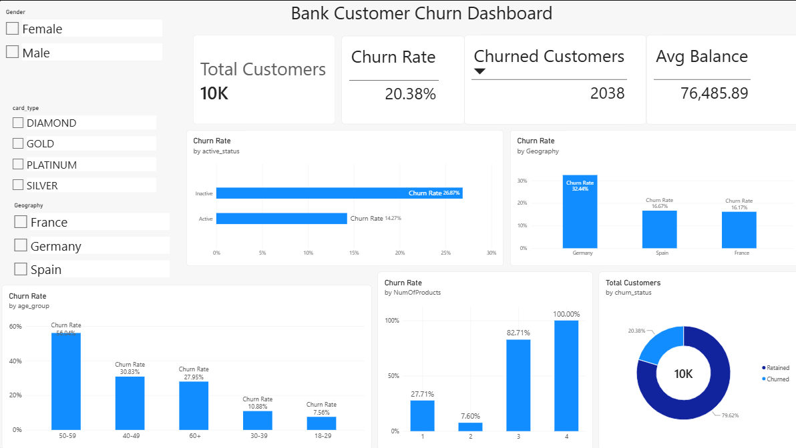

# Bank Customer Churn Analysis

End-to-end churn analysis using **Python, MySQL and Power BI**. The project cleans 10,000 bank customer records, finds which segments churn most using SQL, and presents the results in an interactive dashboard.



## Objective

Identify which customer segments are most likely to leave the bank and turn raw data into clear, business-focused insights.

## Tools

- **Python** (pandas) for data profiling, cleaning and feature engineering
- **MySQL** (via XAMPP) for validation and SQL-based analysis
- **Power BI** for the interactive dashboard
- **Git / GitHub** for version control

## Dataset

Bank Customer Churn (Kaggle)by Radheshyam Kollipara: 10,000 customers, 18 columns (geography, gender, age, tenure, balance, credit score, products, activity, card type, satisfaction, etc.).

## Workflow

1. **Profile and clean** the data: checked types, nulls and duplicates (none found).
2. **Feature engineering:** age group, tenure group, balance band, credit score band, and readable labels for churn, activity and complaints.
3. **Load into MySQL** and validate the row count (10,000).
4. **Analyse with SQL:** churn by geography, age, products, activity, gender, balance and tenure, plus a high-risk segment.
5. **Build the Power BI dashboard:** KPI cards, churn-rate charts, a churn vs retained donut, and slicers for gender, geography and card type.

## Key Insights

| Segment | Churn rate |
|---|---|
| **Overall** | **20.38%** (2,038 of 10,000) |
| Germany | 32.44% |
| Spain / France | 16.67% / 16.17% |
| Age 50-59 | 56% |
| Age 18-29 | 7.56% |
| 1 product | 27.71% |
| 2 products | 7.60% |
| 3 products | 82.71% |
| 4 products | 100% |
| Inactive members | 26.87% |
| Active members | 14.27% |

## Recommendations

- **Target customers aged 40+**, especially 50-59, with retention offers and relationship calls.
- **Re-engage inactive members** early, before they leave.
- **Review the 3-4 product bundles.** Almost all customers with 3+ products churn, which points to a product or pricing problem.
- **Investigate service quality in Germany**, which churns about twice as much as France and Spain.
- **Promote the 2-product setup**, which has the lowest churn.

## Data Note

The `Complain` column almost perfectly matches churn (target leakage). It should be excluded if this data is used to build a predictive model.

## Project Structure

```
bank-churn-analysis/
├── data/          # raw and cleaned CSV files
├── scripts/       # Python cleaning and MySQL loading scripts
├── sql/           # analysis.sql with all queries
├── dashboard/     # Power BI file (.pbix) and screenshot
└── README.md
```

## How to Run

1. Install the libraries:
   ```
   pip install pandas sqlalchemy pymysql
   ```
2. Clean the data (creates `data/clean_bank_churn.csv`):
   ```
   python scripts/01_cleaning.py
   ```
3. Start MySQL and create the database:
   ```sql
   CREATE DATABASE bank_churn;
   ```
4. Load the data (set your own password; never commit it):
   ```
   $env:DB_PASSWORD="your_password"
   python scripts/load_mysql2.py
   ```
5. Run the queries in `sql/analysis.sql`.
6. Open `dashboard/bank_churn_dashboard.pbix` in Power BI Desktop.

## Author
Rishita Kumawat 
